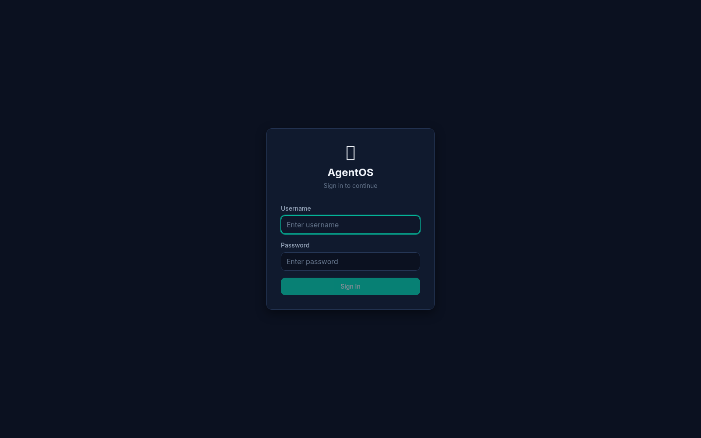
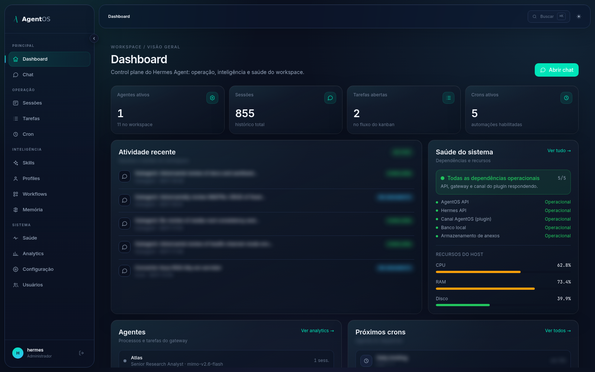
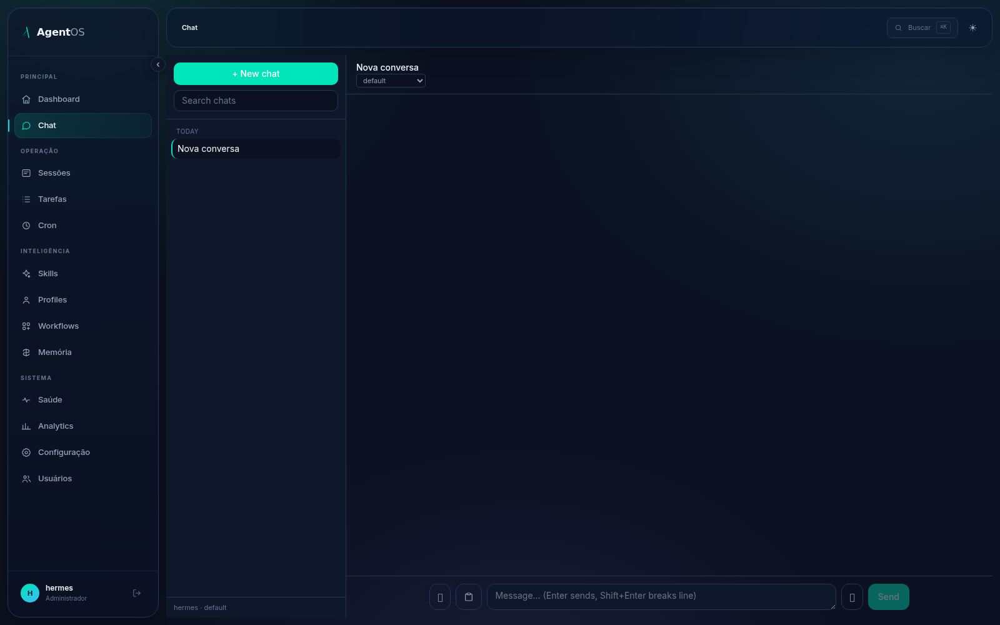
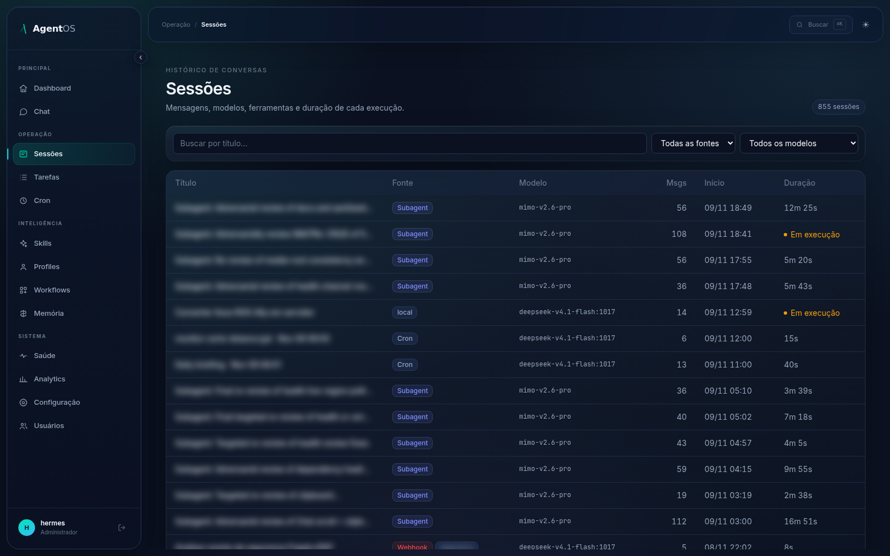
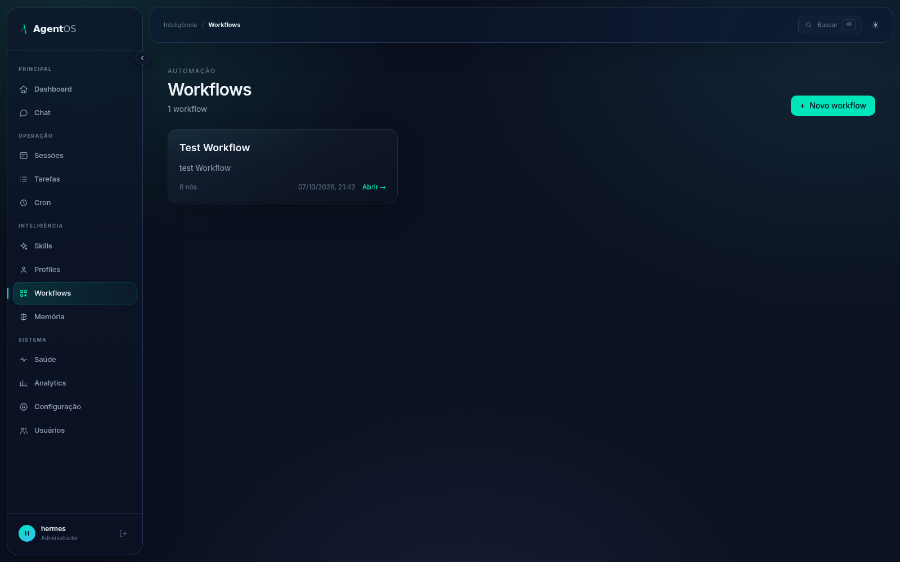
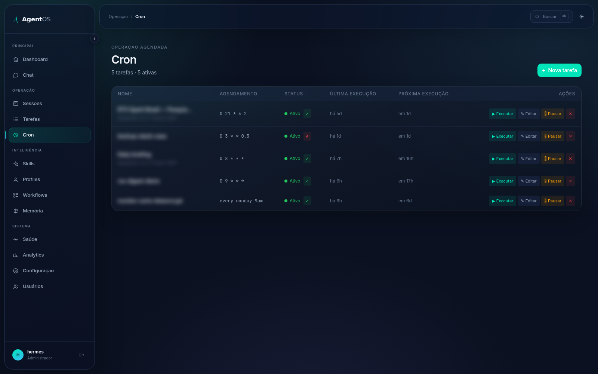
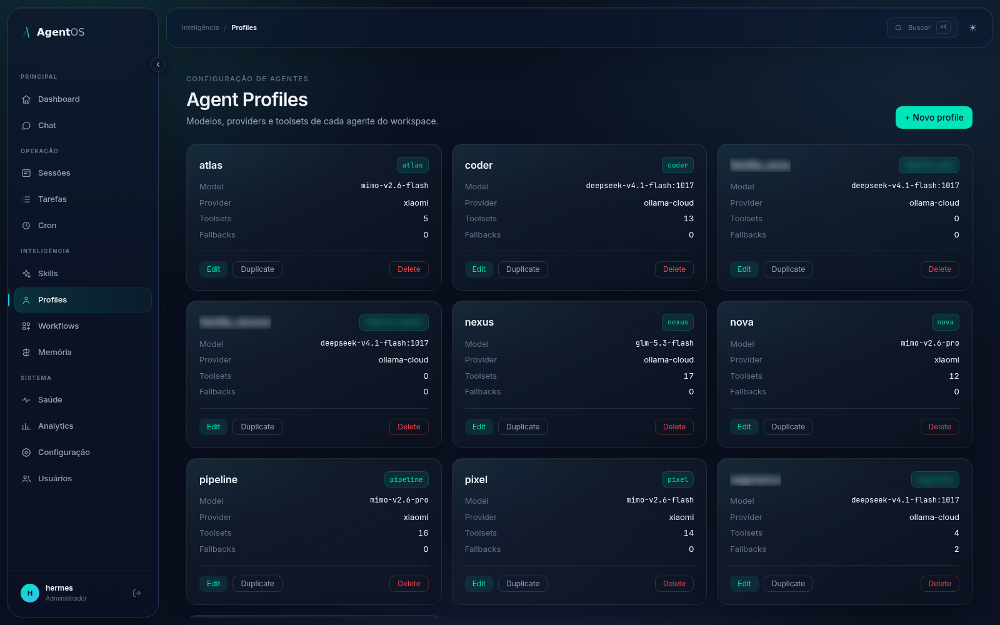
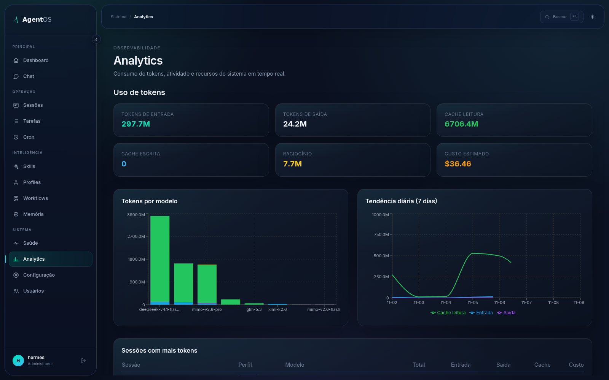
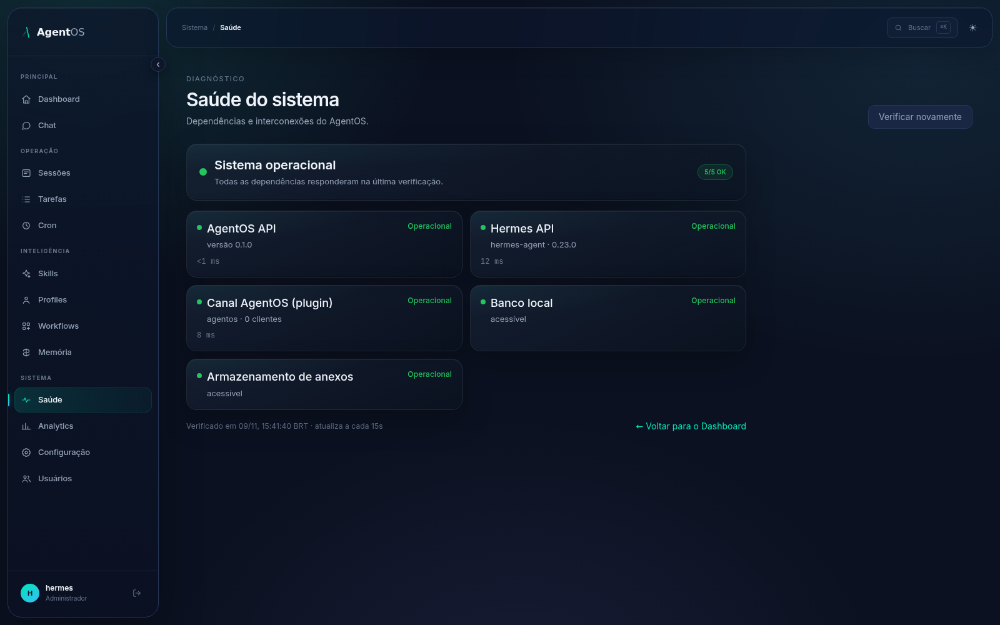
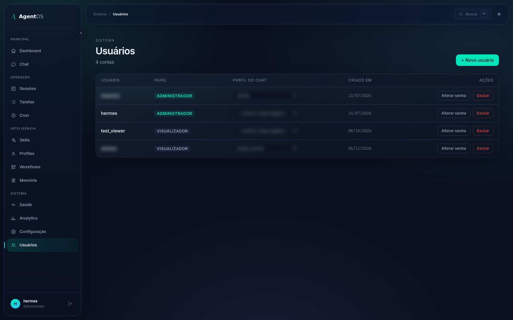

# AgentOS

A web UI control plane for [Hermes Agent](https://hermes-agent.nousresearch.com) — dashboard, session history, kanban board, cron editor, profile editor, and more. Runs as an s6 service inside the Hermes container, or standalone alongside any Hermes installation.

**Version:** 0.1.0

## Chat transport

AgentOS supports two transports for chat turns:

- **Plugin mode (recommended)** — `AGENTOS_CHANNEL=plugin`: AgentOS connects to the Hermes `agentos-channel` plugin over WebSocket (`ws://127.0.0.1:9130/ws`), enabling per-user identity, streaming drafts, thinking/tool frames, native approval cards and reconnect/resume.
- **Legacy HTTP mode** — `AGENTOS_CHANNEL=http`: AgentOS calls the Hermes HTTP API (`HERMES_API_URL`).

Both modes are supported at the moment. Environment variables and operational details are in [CHANNEL.md](CHANNEL.md).

## Features

- **App shell** — Collapsible sidebar (state persisted in `localStorage`), contextual top bar, frosted-glass chrome, mobile drawer, and light/dark themes
- **Agent Dashboard** — Live status cards for Hermes profiles, recent activity, system-resource meters, and a dependency-health summary linking to the full health page
- **Chat with Hermes** — Streamed replies, thinking/tool timeline groups, markdown, attachments (clipboard paste included), approval cards, voice input, read-aloud replies (Edge TTS by default, optional local Kokoro), a per-session usage line for admins (context size vs. model window, tokens, cache, API calls; cost only when the model has pricing), session titles taken from the Hermes session (the gateway's automatic name replaces the first-message placeholder; renames are applied through the gateway API; if it is unreachable the new name shows locally and is delivered later), and a per-user chat profile. Uses the **agentos-channel plugin** (recommended) or the legacy HTTP transport; see [CHANNEL.md](CHANNEL.md)
- **System Health** — `/system-health` shows AgentOS, Hermes API, channel/plugin, auth database, and uploads, with latency, status and a manual re-check
- **Session History** — Browse, search, and filter conversation sessions with FTS5 full-text search
- **Session Detail** — Read-only transcript with reasoning blocks, tool-call expansion, pagination and follow-tail navigation
- **Kanban Board** — Task board with drag-and-drop, markdown cards, task detail, runs, comments, artifacts and logs
- **Analytics Dashboard** — Token usage (per-model, cache, reasoning, cost), 7-day trends, activity heatmap, and host resources
- **Skills Hub** — Grid of installed skills with categories, search, sorting, detail modal and per-profile usage
- **Workflow Editor** — React Flow canvas with trigger/action/condition nodes, CRUD, execution history and node results
- **Cron Job Editor** — CRUD, run-now, pause/resume, schedules and delivery settings
- **Profiles** — Profile cards plus a 6-tab editor: Model, Agent, Toolsets, Description, Memory (SOUL.md) and Preview; per-user chat-profile mapping
- **Memory Monitor** — Honcho workspaces, peers, representation health, queue and recent conclusions, isolated per profile
- **Config Viewer/Editor** — Tree + YAML views with secret redaction, atomic writes and admin-only editing
- **Users & Auth** — JWT login, roles, password management, per-user chat profile, token refresh
- **Markdown Everywhere** — react-markdown + remark-gfm + rehype-highlight in chat, cards, comments and tasks
- **Responsive** — Desktop sidebar, tablet rail, mobile drawer; verified down to 390 px (320 px is a known cosmetic debt)
- **Cross-platform** — Runs as an s6 service inside the Hermes container, or standalone alongside a Hermes installation

## Screenshots

The committed screenshots use the current shell. Personal names, real user rows and
internal session/job titles are blurred; generic service/test accounts remain visible.
Do not commit a screenshot with readable personal data or credentials.

### Login



### Dashboard — health, activity and resources



### Chat — channel-backed conversation



### Sessions — history and search



### Workflows — canvas editor



### Cron — scheduled jobs



### Profiles — per-agent configuration



### Analytics — tokens, trends and host resources



### System health — dependencies and interconnections



### Users — accounts and chat-profile mapping



## Quick Start (Dev Mode)

```bash
cd agentos

# Backend
python3 -m venv .venv
. .venv/bin/activate
pip install -e .
python3 -m uvicorn backend.main:app --host 0.0.0.0 --port 9120

# Frontend (another terminal)
cd frontend
npm install
npm run dev
```

Backend runs on http://localhost:9120, frontend dev server on http://localhost:5173.

### First-Run Authentication

AgentOS does **not** ship a default `admin`/`admin` account. On an empty database,
create the first admin through the first-run endpoint (it only works while no users
exist):

```bash
curl -sS -X POST http://localhost:9120/api/auth/register-first \
  -H 'Content-Type: application/json' \
  -d '{"username":"admin","password":"your-secure-password"}'
```

The response contains the access/refresh tokens and the new admin user. After that,
manage accounts at `/settings` (admin) or with the authenticated
`POST /api/auth/register` endpoint. The login page has no pre-filled credentials.

For production, build the frontend and serve via FastAPI:

```bash
cd frontend && npm run build
# Built assets go to frontend/dist/ — FastAPI serves them at /
```


## Testing

The canonical test suite runs entirely against an isolated sandbox (throwaway
data dir + throwaway databases) — no real users, workspaces or cron jobs are
ever touched.

```bash
# one-time: create the environment (Python 3.11+)
python -m venv .venv && source .venv/bin/activate
pip install -e ".[test]"

# backend suite
pytest

# frontend type-check + production build
cd frontend && npm ci && npx tsc --noEmit && npm run build
```

Covered areas: config editing (`_apply_patch`), workspace containment,
the authorization matrix (admin × viewer), token lifecycle (strict claims,
revocation, refresh rotation), media/artifact transport (no tokens in URLs)
and cron store integrity (lost updates under concurrency, honest dispatch).
CI runs both jobs on every push (`.github/workflows/tests.yml`).

## Installation for AI Agents

> **This section is designed for AI agents (Hermes, Claude, GPT, etc.) to install AgentOS automatically.** Follow these steps based on your environment.

### Prerequisites Check

Before starting, verify:
```bash
# Check Python version (3.11+ required)
python3 --version

# Check Node.js (18+ required)
node --version

# Check if Hermes is running
ps aux | grep hermes

# Check if s6 is available (Docker container)
ls /run/s6/services/ 2>/dev/null || echo "Not in s6 container"
```

### Option 1: s6 Docker Container (Recommended)

If you're running inside a Hermes Docker container with s6-overlay:

```bash
# 1. Clone or download AgentOS
cd /opt/data
git clone https://github.com/Bendak/hermes-agentos.git agentos 2>/dev/null || cd agentos && git pull

# 2. Install Python dependencies
cd /opt/data/agentos
pip install -e .

# 3. Build frontend
cd /opt/data/agentos/frontend
npm install
npm run build

# 4. Create s6 service directory
mkdir -p /opt/data/s6-agentos

# 5. Create s6 run script
cat > /opt/data/s6-agentos/run << 'EOF'
#!/command/execlineb -P
cd /opt/data/agentos
s6-setuidgid hermes
python3 -m uvicorn backend.main:app --host 0.0.0.0 --port 9120
EOF
chmod +x /opt/data/s6-agentos/run

# 6. Create finish script
cat > /opt/data/s6-agentos/finish << 'EOF'
#!/bin/sh
exit 0
EOF
chmod +x /opt/data/s6-agentos/finish

# 7. Link to s6 services (if s6 is available)
if [ -d "/run/s6/services" ]; then
    ln -sf /opt/data/s6-agentos /run/s6/services/agentos
    echo "AgentOS linked to s6 services"
fi

# 8. Start the service
cd /opt/data/agentos
nohup python3 -m uvicorn backend.main:app --host 0.0.0.0 --port 9120 > /tmp/agentos.log 2>&1 &
echo "AgentOS started on port 9120"

# 9. Verify it's running
sleep 2
curl -s http://localhost:9120/health || echo "Health check failed"
```

### Option 2: Linux Desktop / WSL

```bash
# 1. Install dependencies
sudo apt update
sudo apt install -y python3 python3-pip nodejs npm

# 2. Clone AgentOS
cd ~
git clone https://github.com/Bendak/hermes-agentos.git agentos
cd agentos

# 3. Install Python packages
pip3 install -e .

# 4. Build frontend
cd frontend
npm install
npm run build
cd ..

# 5. Create systemd service (optional)
sudo tee /etc/systemd/system/agentos.service << EOF
[Unit]
Description=AgentOS
After=network.target

[Service]
Type=simple
User=$USER
WorkingDirectory=$HOME/agentos
ExecStart=$(which python3) -m uvicorn backend.main:app --host 0.0.0.0 --port 9120
Restart=always

[Install]
WantedBy=multi-user.target
EOF

# 6. Enable and start
sudo systemctl daemon-reload
sudo systemctl enable agentos
sudo systemctl start agentos

# 7. Verify
curl -s http://localhost:9120/health
echo "AgentOS running at http://localhost:9120"
```

### Option 3: Windows PowerShell

```powershell
# 1. Check prerequisites
python --version
node --version

# 2. Clone AgentOS
cd $env:USERPROFILE
git clone https://github.com/Bendak/hermes-agentos.git agentos
cd agentos

# 3. Install Python packages
pip install -e .

# 4. Build frontend
cd frontend
npm install
npm run build
cd ..

# 5. Create startup script
@"
@echo off
cd /d "%USERPROFILE%\agentos"
python -m uvicorn backend.main:app --host 0.0.0.0 --port 9120
pause
"@ | Out-File -FilePath start-agentos.bat -Encoding ASCII

# 6. Start AgentOS
Start-Process -FilePath "start-agentos.bat" -WindowStyle Normal

# 7. Verify
Start-Sleep -Seconds 2
try {
    $response = Invoke-WebRequest -Uri "http://localhost:9120/health" -UseBasicParsing
    Write-Host "AgentOS running at http://localhost:9120"
} catch {
    Write-Host "Health check failed - check logs"
}
```

### Configuration

After installation, configure AgentOS:

```bash
# Edit config (if needed)
nano /opt/data/agentos/backend/config.py

# Key settings:
# - KANBAN_DB: Path to kanban database (default: /opt/data/kanban.db)
# - STATE_DB: Path to state database (default: /opt/data/state.db)
# - ALLOWED_ORIGINS: CORS origins (default: *)
```

### Verification

After installation, verify everything works:

```bash
# Health check
curl http://localhost:9120/health

# List tasks (should return JSON)
curl http://localhost:9120/api/tasks

# Open in browser
echo "Open http://localhost:9120 in your browser"
```

### Troubleshooting

**Port already in use:**
```bash
lsof -i :9120
kill -9 <PID>
```

**Database not found:**
```bash
# Create empty databases if missing
touch /opt/data/kanban.db /opt/data/state.db
```

**Frontend not loading:**
```bash
# Rebuild frontend
cd /opt/data/agentos/frontend
npm run build
```

**Permission denied:**
```bash
# Fix permissions
chmod -R 755 /opt/data/agentos
chown -R $(whoami):$(whoami) /opt/data/agentos
```

## Configuration

AgentOS auto-detects your Hermes data directory:

| Environment | Default Path | Detection |
|---|---|---|
| Docker container | `/opt/data` | Marker file `/opt/data/.hermes` |
| Linux / macOS | `~/.hermes` | Home directory fallback |
| Windows | `%USERPROFILE%\.hermes` | Home directory fallback |

Override with environment variables:

```bash
AGENTOS_DATA_DIR=/custom/path    # Explicit override
HERMES_DATA_DIR=/hermes/path     # Hermes native variable (also detected)
```

### Chat channel

| Variable | Default | Purpose |
|---|---|---|
| `AGENTOS_CHANNEL` | `http` when unset | `plugin` (recommended) or `http` (legacy) |
| `AGENTOS_CHANNEL_URL` | `ws://127.0.0.1:9130/ws` | Plugin WebSocket endpoint |
| `AGENTOS_CHANNEL_TOKEN` | — | Shared secret with the `agentos-channel` plugin |
| `AGENTOS_CHANNEL_MEDIA_ROOT` | `<data>/agentos/uploads` | Allowed root for inbound/outbound attachments |
| `AGENTOS_CHANNEL_MAX_MEDIA_MB` | `25` | Attachment size cap (plugin side) |
| `HERMES_API_URL` | `http://localhost:8642` | Hermes HTTP API used by legacy mode |

The AgentOS s6 service does not receive these variables directly; when they are not in
the process environment they are resolved from `<AGENTOS_DATA_DIR>/.env` by
`backend.channel_client`. Restart only the AgentOS service after changing them. See
[CHANNEL.md](CHANNEL.md).

### Chat voice and usage

| Variable | Default | Purpose |
|---|---|---|
| `AGENTOS_TTS_PROVIDER` | `edge` | `edge` (network, no host CPU) or `kokoro` (local; falls back to Edge on failure) |
| `AGENTOS_TTS_VOICE` | `pt-BR-AntonioNeural` | Edge voice |
| `AGENTOS_KOKORO_PYTHON` | — | Python of a separate venv with `kokoro` + `soundfile` (required for `kokoro`) |
| `AGENTOS_KOKORO_VOICE` / `AGENTOS_KOKORO_LANG` | `pf_dora` / `p` | Kokoro voice and language code |
| `AGENTOS_KOKORO_HF_CACHE` | `<data>/home/.cache/huggingface/hub` | Where the Kokoro weights are cached |
| `AGENTOS_CONTEXT_WINDOW` | — | Fixed context window for the usage bar (overrides lookup) |
| `AGENTOS_HERMES_PYTHON` / `AGENTOS_HERMES_SRC` | `/opt/hermes/.venv/bin/python` / `/opt/hermes` | Used to ask Hermes' model metadata for the context window |

Kokoro runs out of process, one synthesis at a time, at `nice 19` / `ionice idle` when those tools exist on the host; the
reply text reaches the worker on stdin. Usage is read from the profile's `state.db`
in read-only mode; the context size is the prompt size the provider reported on the
last call, so the bar appears after the first reply.

### Deployment-specific config (never committed)

Real profile names, usernames and peer ids are deployment data, not source. Keep them
in the untracked `<AGENTOS_DATA_DIR>/.env`:

| Variable | Purpose |
|---|---|
| `HIDDEN_PROFILES` | Comma-separated profiles hidden from non-admin pickers (e.g. private chat profiles) |
| `HONCHO_HUMAN_PEERS` | Comma-separated Honcho peer ids shown in the memory monitor |

The public repository ships **no default family names, private domains, internal IPs,
server hostnames or real profile mappings**. The `Secrets Check` workflow rejects
tracked `.env`/key files and private RFC1918 addresses; add a `PII_PATTERNS` repository
secret to extend it with deployment-specific names.

`AGENTOS_CHAT_PROFILES` remains a legacy process-env map; for normal use assign each
user's chat profile in `/settings` (stored in the local DB, not in git).

### Profile Discovery

AgentOS discovers profiles from two locations:

1. **Default profile** — `config.yaml`, `SOUL.md`, `gateway_state.json` at the data root (e.g. `/opt/data/`)
2. **Sub-profiles** — Each subdirectory under `profiles/` (e.g. `/opt/data/profiles/coder/`)

All profiles are shown on the dashboard with live gateway state, model info, and session counts.

## Architecture

```
┌─────────────────┐
│   Browser       │
│  AgentOS :9120  │
└────────┬────────┘
         │
┌────────▼────────┐
│   AgentOS       │
│  FastAPI +      │
│  React (Vite)   │
└───┬─────────┬───┘
    │         │
    │         └──────────────► Hermes HTTP API :8642   (legacy mode)
    │
    └────────────────────────► agentos-channel plugin :9130 (recommended)
                                   │
                              Hermes gateway
                              state.db / kanban.db
                              profiles/ / config.yaml
```

AgentOS reads Hermes state directly from:
- `state.db` (SQLite) — session history, messages, FTS5 search
- `kanban.db` (SQLite) — task board, task runs, comments (read + write for status updates)
- `config.yaml` + `profiles/*/config.yaml` — agent model, provider info
- `gateway_state.json` — live gateway PID and state
- `SOUL.md` — agent role description

## API Endpoints

Selected endpoints (the live OpenAPI schema is at `/docs`):

| Endpoint | Description |
|---|---|
| `GET /health` | Public liveness check |
| `GET /api/health/status` | Authenticated dependency snapshot (AgentOS, Hermes, channel, DB, uploads) |
| `GET /api/agents` | List all profiles with live status |
| `GET /api/sessions` | Paginated session list with filters (search, profile, date) |
| `GET /api/sessions/{id}` | Session metadata |
| `GET /api/sessions/{id}/messages` | Chat messages with pagination |
| `GET /api/tasks` | Kanban board tasks |
| `GET /api/tasks/{id}` | Task detail with runs and comments |
| `PATCH /api/tasks/{id}` | Update task status (drag-and-drop) |
| `GET /api/config` | Config tree (secrets redacted) |
| `GET /api/config/raw` | Config as YAML text (secrets redacted) |
| `PATCH /api/config` | Update config fields (secret fields rejected) |
| `GET /api/honcho/summary` | Honcho workspaces, peers and representation health |
| `GET /api/skills` | List all installed skills (metadata only) |
| `GET /api/skills/{slug}` | Get skill detail (full SKILL.md + file list) |
| `GET /api/profiles` | List profiles with model, skill counts, external dirs |
| `POST /api/auth/login` | Login (returns JWT token) |
| `POST /api/auth/register-first` | Create the first admin (only while no users exist) |
| `POST /api/auth/refresh` | Refresh an access token |
| `GET /api/auth/check` | First-run/user-exists check |
| `GET /api/auth/me` | Current user info |
| `POST /api/auth/logout` | Logout (invalidate token) |
| `GET /api/auth/users` | List all users (admin) |
| `PUT /api/auth/users/{id}/profile` | Set a user's chat profile (admin) |
| `PUT /api/auth/users/{id}/password` | Change user password (admin) |
| `DELETE /api/auth/users/{id}` | Delete user (admin) |
| `GET /api/chat/sessions` | List the current user's chat sessions (titles mirrored from the Hermes session) |
| `PATCH /api/chat/sessions/{id}` | Rename/archive; the rename is applied through the gateway (`409` if Hermes refuses the title, e.g. already used by another session of that profile) |
| `POST /api/chat/sessions` | Create a chat session |
| `POST /api/chat/sessions/{id}/stream` | Stream a chat turn (SSE) |
| `GET /api/chat/sessions/{id}/usage` | Tokens, cache, API calls and context size of the session |
| `POST /api/chat/uploads` | Upload an attachment |
| `POST /api/chat/approvals` | Resolve an approval card |
| `POST /api/voice` | Transcribe voice input |
| `POST /api/tts` | Read a reply aloud (markdown cleaned server-side) |
| `GET /api/workflows` | List all workflows |
| `GET /api/workflows/{id}` | Get workflow detail (nodes + edges) |
| `POST /api/workflows` | Create new workflow |
| `PUT /api/workflows/{id}` | Update workflow (name, nodes, edges) |
| `DELETE /api/workflows/{id}` | Delete workflow |
| `POST /api/workflows/{id}/run` | Execute workflow (toposort engine) |
| `GET /api/workflows/{id}/runs` | Get workflow run history |
| `GET /api/runs/{id}` | Get run detail with node results |
| `GET /api/cron` | List all cron jobs |
| `POST /api/cron` | Create cron job |
| `PUT /api/cron/{id}` | Update cron job |
| `DELETE /api/cron/{id}` | Delete cron job |
| `POST /api/cron/{id}/run` | Run cron job now |
| `POST /api/cron/{id}/pause` | Pause cron job |
| `POST /api/cron/{id}/resume` | Resume cron job |
| `GET /api/profiles/{name}` | Get profile detail with config + soul |
| `PUT /api/profiles/{name}/soul` | Write SOUL.md content |

## Tech Stack

- **Backend** — FastAPI (Python 3.11+), SQLite, uvicorn, aiosqlite
- **Frontend** — React 18, Vite 5, Tailwind CSS, TanStack Query, React Router, @dnd-kit (drag-and-drop), React Flow (workflow canvas), react-markdown + remark-gfm + rehype-highlight
- **Auth** — JWT (stdlib hmac), bcrypt-free password hashing (`hashlib.pbkdf2_hmac`), no C dependencies
- **Fonts** — Inter (UI), JetBrains Mono (code/data)
- **Design** — Dark theme (`#0B1120` base), teal accent (`#00E5B9`), gold secondary (`#F5B800`)

## Roadmap

- [x] Phase 0 — Bootstrap (FastAPI + Vite scaffold)
- [x] Phase 1 — Agent Dashboard (live health cards, dynamic profile discovery)
- [x] Phase 2 — Session History (list, search, FTS5, pagination, filters)
- [x] Phase 3 — Session Detail (chat thread, reasoning blocks, tool calls)
- [x] Phase 3.5 — Markdown rendering (react-markdown, syntax highlighting, GFM)
- [x] Phase 4 — Kanban Board (read-only, 5 columns, task detail, archived toggle)
- [x] Phase 5 — Kanban Drag & Drop (@dnd-kit, PATCH endpoint, markdown in cards)
- [x] Phase 6 — Task Detail Panel (tabs: Overview, Runs, Comments, Children)
- [x] Phase 7 — Config Viewer (read-only tree + YAML view, secret redaction)
- [x] Phase 8 — Config Editor (inline editing, atomic write, secret field protection)
- [x] Visual Identity — DESIGN.md spec, dark mission-control theme, Pixel design refinement
- [x] s6 Autostart — cont-init.d script, survives container rebuilds
- [x] Phase 9 — Skills Hub (browse installed skills, search, filter, detail modal)
- [x] Phase 10 — Workflow Editor (React Flow canvas, CRUD, node palette, dark theme)
- [x] Phase 11 — Workflow Execution (toposort engine, Run Now, run history, node config)
- [x] Phase 12 — Polish (dark/light toggle, ⌘K search, nav shortcuts, responsive)
- [x] Phase 13 — Auth (JWT, login page, ProtectedRoute, AuthContext, multi-user)
- [x] Phase 14 — Kanban Integration (task editor, filters/search, comments, bulk ops, webhook)
- [x] Phase 15 — User Management (Settings page, create/delete users, change passwords)
- [x] Phase 16 — Cron Job Editor (CRUD, run now, pause/resume, edit schedule/prompt)
- [x] Phase 17 — Profile Editor (6 tabs: Model, Agent, Toolsets, Description, Memory, Preview)
- [x] Phase 18 — Shell Branding 2026 (sidebar shell, contextual top bar, `.brand-card`, responsive rail/drawer)
- [x] Phase 19 — Chat channel (agentos-channel plugin + legacy HTTP, streaming, tools, approvals, attachments)
- [x] Phase 20 — Dependency health (dashboard summary + `/system-health` page)
- [x] Phase 21 — Family profiles (per-user chat profile, scoped sessions, isolated Honcho memory)
- [x] Phase 22 — Chat voice and usage (read-aloud replies, auto-read toggle, session usage and context bar)

See [PLAN.md](PLAN.md) for the full roadmap, [CHANNEL.md](CHANNEL.md) for chat transport, and [DESIGN.md](DESIGN.md) for the visual identity spec.

## License

MIT
